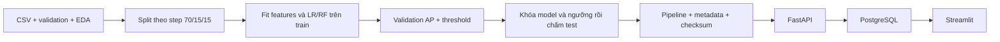

# TransactionGuard AI

Dự án phân tích gian lận trên giao dịch **giả lập**, gồm pipeline ML, FastAPI, lịch sử PostgreSQL, MLflow và dashboard Streamlit. Cờ cảnh báo đề nghị **kiểm tra thủ công**, không từ chối thanh toán. Không tích hợp ngân hàng thật.

Yêu cầu gốc: [TransactionGuard_AI_REQUIREMENTS.md](TransactionGuard_AI_REQUIREMENTS.md). Mã P0/P1 đã được triển khai; hiệu năng PaySim chỉ xác nhận sau khi tải dữ liệu và train. Isolation Forest, calibration và drift là mở rộng P2 chưa triển khai.

## Chạy nhanh với dữ liệu demo

Cần Python **3.11/3.12**, khuyến nghị 4–8 GB RAM khi dùng toàn bộ PaySim.

```bash
python3.12 -m venv .venv
source .venv/bin/activate
python -m pip install -e '.[dev]'
cp .env.example .env
python -m ml.demo_data --output data/raw/demo.csv
python -m ml.eda --data data/raw/demo.csv
python -m ml.train --data data/raw/demo.csv --dataset-name 'Artificial smoke-test fixture (NOT PaySim)'
pytest -q
uvicorn app.main:app --reload
```

Nếu dùng `uv`: `uv venv --python 3.12 .venv`, sau đó `uv pip install -e '.[dev]'`.
Swagger: <http://localhost:8000/docs>. Các chỉ số trên dữ liệu demo **không phải bằng chứng hiệu năng PaySim**.
`requirements-lock.txt` lưu môi trường Python 3.12 đã kiểm tra, gồm cả tính năng tùy chọn. Tái lập với `uv pip sync requirements-lock.txt` rồi `uv pip install --no-deps -e .`.

## Huấn luyện và đánh giá PaySim

Tải CSV thủ công từ [PaySim trên Kaggle](https://www.kaggle.com/datasets/ealaxi/paysim1) theo điều khoản nguồn, đổi tên thành `data/raw/paysim.csv`. Không đưa dữ liệu gốc lên Git.

```bash
python -m ml.eda --data data/raw/paysim.csv
python -m ml.train --data data/raw/paysim.csv --output artifacts/ --reports reports/
python -m ml.evaluate --artifact artifacts/model.joblib --data data/raw/paysim.csv --split reports/split_summary.json
```

Các CLI hỗ trợ `--help`. Cấu hình seed, precision mục tiêu và tham số hai model ở `configs/training.yaml`; thay bằng `--config path/to/config.yaml`. Dữ liệu thiếu cột, số âm, NaN/Infinity, type/nhãn sai hoặc partition thiếu một lớp làm chương trình dừng với exit code khác 0. Không tự bỏ dòng hoặc chia ngẫu nhiên dự phòng.

Notebook `notebooks/01_eda.ipynb` đọc biến `PAYSIM_PATH` (mặc định `data/raw/paysim.csv`). Mở bằng Jupyter riêng; CLI `ml.eda` cung cấp cùng phân tích không cần cài Jupyter. EDA ghi rõ missing, phân bố lớp/type, duplicate trên cột được đọc; không tự loại duplicate.

## Thiết kế ML



- Chỉ dùng `step`, `type`, `amount`, `oldbalanceOrg`. Khả năng có sẵn các trường trước giao dịch là giả định demo cần kiểm chứng tại hệ thống thực. Không dùng account ID, số dư sau giao dịch, target hoặc `isFlaggedFraud`.
- Split giữ nhóm cùng `step`, chọn ranh giới gần 70%/85% tổng số dòng nhất. Lưu checksum toàn CSV, ranh giới step, số dòng và phân bố lớp để tái lập test chính xác.
- Feature: `log1p(amount)`, `log1p(oldbalanceOrg)`, `amount / max(balance, 1)` chặn **1e6**; cờ amount lớn dùng phân vị 95% tính trên **train**. Lưu toàn bộ transformer, imputer, encoder, scaler và classifier trong sklearn Pipeline.
- Logistic Regression dùng scaling/class weight; Random Forest giới hạn độ sâu/class weight. Chỉ fit preprocessing trên train, không refit trên validation/test.
- Chọn model theo validation **Average Precision (AP)**; ưu tiên LR nếu cách model tốt nhất ≤ 0.001 AP. AP dùng `average_precision_score`, không phải diện tích PR hình thang.
- Ngưỡng chọn recall cao nhất khi precision validation ≥ 0.20; nếu không đạt, ghi rõ fallback sang F1 tốt nhất. Đây là mục tiêu bài tập, không phải yêu cầu nghiệp vụ ngân hàng. Khóa model/ngưỡng trước khi chấm test, không điều chỉnh theo test.
- `fraud_probability` là model-derived score, chưa calibration. `risk_score = round(100 * score)`; low <30, medium 30–69, high ≥70 là dải hiển thị độc lập với ngưỡng flag. Medium vẫn có thể được flag.

Recall cao có thể kéo theo nhiều false positive, precision thấp trên dữ liệu mất cân bằng. Không chọn theo accuracy và không công bố số liệu chưa đo.

| Output | Nội dung |
|---|---|
| `artifacts/model.joblib`, `metadata.json` | Pipeline + version, threshold, checksum, feature order, môi trường và split |
| `reports/eda_summary.json` | Missing, duplicate, phân bố nhãn/type |
| `reports/split_summary.json` | Ranh giới step/checksum và thống kê các tập |
| `reports/model_comparison.csv` | Hai model, validation AP/metrics, baseline 0.5, tham số, thời gian fit |
| `reports/validation_metrics.json` | Lý do chọn model và threshold/fallback |
| `reports/test_metrics.json` | Test AP, Precision, Recall, F1, TP/FP/TN/FN và latency thực đo |
| `reports/confusion_matrix.png`, `precision_recall_curve.png` | Biểu đồ test |
| `reports/eda_distributions.png` | Biểu đồ từ CLI EDA |

Latency ghi thời gian batch/amortized và p50/p95 của 20 lần single-row inference đã warm-up, không gồm HTTP/DB và không phải SLA. `/metrics` đo riêng HTTP latency thực tế. Kết quả có thể khác theo phiên bản thư viện/phần cứng; seed và versions được lưu. Dùng `--output`/`--reports` riêng để giữ thí nghiệm; mặc định ghi đè lần trước. `evaluate` ghi kết quả vào `reports/reproduced`, không tune lại.

## API

```bash
curl -s http://localhost:8000/health
curl -s http://localhost:8000/model-info
curl -s -X POST http://localhost:8000/predict \
  -H 'Content-Type: application/json' \
  -d '{"transaction_id":"txn-1001","step":42,"type":"TRANSFER","amount":12000,"oldbalanceOrg":15000}'
curl -s -X POST http://localhost:8000/batch-predict \
  -H 'Content-Type: application/json' \
  --data-binary @data/sample/sample_transactions.json
```

| Endpoint | Hành vi |
|---|---|
| `GET /health` | 200 khi model sẵn sàng, 503 khi thiếu/hỏng |
| `POST /predict` | Score/flag một giao dịch |
| `POST /batch-predict` | 1–100 giao dịch, một lần gọi vectorized predict_proba |
| `GET /model-info` | Version/algorithm/schema/features/threshold thực tế |
| `GET /predictions?limit=20&offset=0&flagged=true` | Lịch sử phân trang, cần DB |
| `GET /predictions/summary` | Tổng/flag rate/score trung bình/model mới nhất trong DB |
| `GET /metrics` | Request/error count, latency p50/p95, flag rate, dải score, lỗi ghi DB |

ID 1–64 ký tự không trắng, step nguyên không âm, type đúng enum, amount/balance hữu hạn không âm. Trường thừa (bao gồm target), NaN/Infinity, batch rỗng/quá giới hạn/trùng ID trả 422. Cùng input/model cho cùng score. `MAX_BATCH_SIZE` cấu hình trong khoảng 1–100.

Model tải một lần khi startup; không tự train hoặc tạo dự đoán ngẫu nhiên dự phòng. Chỉ load artifact local đáng tin; checksum phát hiện nhầm file, không chứng minh pickle an toàn. HTTP lỗi không trả đường dẫn/traceback; validation không trả lại raw input.

## PostgreSQL

```bash
python -m pip install -e '.[db]'
# Tạo PostgreSQL database, bật DATABASE_URL trong .env theo .env.example.
alembic upgrade head
uvicorn app.main:app --reload
```

Không cấu hình `DATABASE_URL`: API vẫn hoạt động, lịch sử trả 503. Không tự tạo bảng trong API startup. Lưu prediction/type/amount, không có định danh người gửi/người nhận hoặc raw request. Cho phép chấm lại cùng transaction ID. Ghi batch trong một DB transaction.

Khi DB lỗi, prediction vẫn thành công (**fail-open**), ghi warning an toàn và tăng `database_log_failures`; truy vấn lịch sử trả 503. `/metrics` theo từng process, reset khi restart, latency giữ tối đa 10.000 request gần nhất. Flag rate không cho biết FP/FN/precision/recall hoặc drift khi chưa có nhãn xác minh.

## Docker Compose

Tạo model artifact local trước (PaySim hoặc demo có nhãn rõ), rồi:

```bash
docker compose up --build
# Thêm dashboard:
docker compose --profile dashboard up --build
```

PostgreSQL có volume, migration chạy trước API, healthcheck theo thứ tự phụ thuộc. API <http://localhost:8000/docs>, dashboard <http://localhost:8501>. Thông tin DB là demo local; cổng web bind 127.0.0.1; model/reports mount read-only. `docker compose down` dừng và giữ dữ liệu. Môi trường triển khai ban đầu không có Docker, cần xác minh Compose trên máy có Docker.

## MLflow local

```bash
python -m pip install -e '.[tracking]'
python -m ml.train --data data/raw/paysim.csv --mlflow-uri sqlite:///mlflow.db
mlflow ui --backend-store-uri sqlite:///mlflow.db --host 127.0.0.1 --port 5000
```

Hai run có algorithm, seed, params, checksum, features, preprocessing version, split và validation metrics. Run model được chọn thêm artifact/metadata và metrics `final_test_*` riêng. Tracking local không cần cloud; có thể dùng `--mlflow-uri file:./mlruns` nếu MLflow hỗ trợ file store.

## Dashboard

```bash
python -m pip install -e '.[dashboard]'
streamlit run dashboard/main.py
```

`API_URL` mặc định `http://localhost:8000`, `REPORTS_DIR` mặc định `reports`. Bốn màn hình: Overview, Predictions (sort/filter/phân trang), Model Evaluation (offline test), Try a transaction (dữ liệu demo). Thiếu API/lịch sử/report sẽ hiện thông báo. Không có hành động thanh toán.

## Kiểm thử và giới hạn

```bash
python -m pip install -e '.[dev,db]'
pytest -q
ruff check .
ruff format --check .
```

Test không cần mạng, PaySim, artifact thật hoặc DB server. Integration chạy train → save → reload → predict → evaluate; kiểm tra metrics tái lập, checksum/schema lỗi, feature leakage, threshold, batch vectorization. History test dùng SQLite; PostgreSQL thật cần kiểm tra thêm bằng Compose. CI kiểm tra Python 3.11/3.12.

### Kết quả đã kiểm chứng trong môi trường phát triển

Python 3.12: **50 tests passed**, `ruff check .` và `ruff format --check .` đạt.
Đã kiểm tra bốn màn hình Streamlit, form dự đoán và trạng thái API lỗi bằng AppTest;
migration SQLite chạy thành công, `alembic check` không phát hiện schema lệch.
Hai run MLflow local có trạng thái `FINISHED`.

Bảng dưới chỉ là kết quả thực đo trên **2.400 dòng dữ liệu tự tạo bởi `ml.demo_data`**, seed 42,
không phải PaySim và không đại diện cho bài toán gian lận thực tế:

| Model | Validation AP | Validation precision | Validation recall |
|---|---:|---:|---:|
| Logistic Regression | 0.8495 | 0.2093 | 0.9231 |
| Random Forest | 0.8329 | 0.2446 | 0.8718 |

Model được chọn: Logistic Regression, ngưỡng validation 0.255987.
Test demo 360 dòng: AP 0.8824, precision 0.2222, recall 0.9091, F1 0.3571;
TN/FP/FN/TP = 176/140/4/40. Lệnh `ml.evaluate` tái lập đúng các chỉ số này.
Latency inference một dòng tại lần chạy này: p50 3.16 ms, p95 3.74 ms (20 mẫu, không phải SLA).
Chưa chạy dữ liệu PaySim hoặc PostgreSQL/Docker thật. Notebook đã kiểm tra cú pháp;
chưa chạy notebook bằng kernel Jupyter với PaySim.

Tham khảo: [sklearn precision–recall](https://scikit-learn.org/stable/modules/generated/sklearn.metrics.precision_recall_curve.html), [FastAPI lifespan](https://fastapi.tiangolo.com/advanced/events/). Phạm vi là demo local dữ liệu giả lập, chưa có authentication/rate limiting/production access control.
